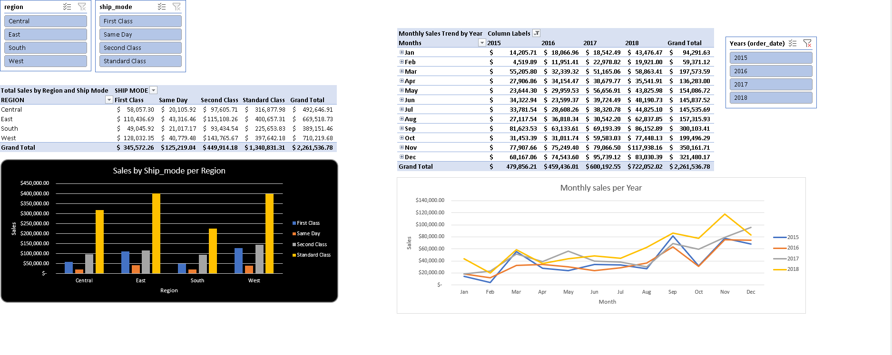
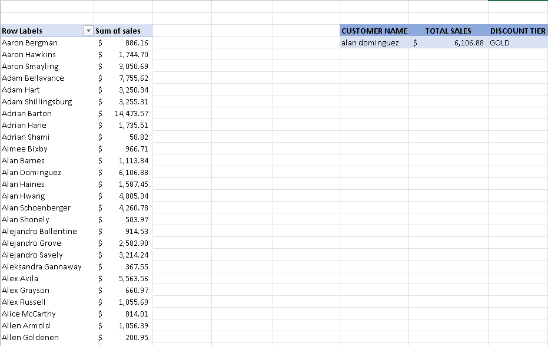
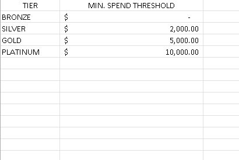
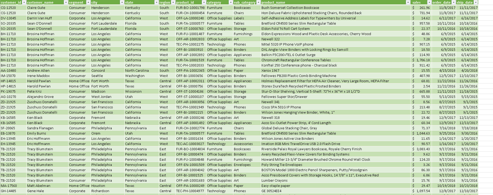

# Superstore Sales Analysis (Excel)

An Excel workbook built on 9,800 rows of Superstore sales data. A Dashboard sheet with pivot tables, charts and slicers shows sales by region, shipping mode and year, and a lookup tool assigns each customer a discount tier based on total spend.

## Preview

**Dashboard**

**Customer discount tier lookup**

**Tier thresholds**

**Data (live query from MySQL)**

## What It Shows

| Sheet | Contents |
|---|---|
| Dashboard | Sales by region and shipping mode (pivot and column chart), monthly sales by year (pivot and line chart), slicers for region, ship mode and year |
| Discount Tier | Pick a customer from a dropdown to see their total sales (XLOOKUP) and discount tier (INDEX/MATCH) |
| Tier Reference | Spend thresholds behind the tiers: Bronze $0, Silver $2,000, Gold $5,000, Platinum $10,000 |
| Data | The Superstore table, loaded live from MySQL |

## Key Insights

1. **Sales grew after a dip in 2016.** Yearly sales went from about $480K (2015) to $459K (2016), then rose 31% to $600K (2017) and another 20% to $722K (2018).
2. **The late-year peak repeats every year.** Sales climb from September to December in all four years, and November 2018 is the single highest month at about $118K. February is at or near the weakest month each year.
3. **Standard Class dominates shipping.** It accounts for about 59% of sales ($1.34M), while Same Day is only about 5.5% ($125K).
4. **West leans furthest toward faster shipping.** About 24% of West's sales ship First Class or Same Day, compared with about 16% in Central, where Standard Class reaches 64%.

## How I Built It

- **Data:** [Superstore Sales Dataset](https://www.kaggle.com/datasets/rohitsahoo/sales-forecasting) from Kaggle, loaded into MySQL. Dates were converted from text (DD/MM/YYYY) to proper date types in SQL before the data reached Excel.
- **Connection:** Excel connects directly to the MySQL database. A CSV export broke because some product names contain quotation marks, which shifted columns, so a direct connection was more reliable.
- **Lookup tool:** XLOOKUP pulls a customer's total sales, and INDEX/MATCH assigns the tier using an approximate match against the sorted spend thresholds. Both are included because XLOOKUP is not available in older Excel versions, while INDEX/MATCH works everywhere.

## Notes

- Download `Book1.xlsx` and open it in Excel. Excel may show a warning about external data connections. That's expected, and you don't need to enable it.
- The workbook was built against a local MySQL database, so **Refresh will not work on other machines**. The data is stored in the file.
- This dataset has no profit column, so the analysis is revenue-based.

## What I Learned

- XLOOKUP and INDEX/MATCH solve the same lookup, but INDEX/MATCH is the safer choice when a file may be opened in older Excel versions.
- An approximate-match lookup depends on the threshold table being sorted in ascending order. Otherwise it returns the wrong tier.
- Connecting Excel directly to the database avoided a CSV export problem and keeps the data refreshable on my own machine.

## Related Projects

- [SQL analysis](https://github.com/earl-patawaran/superstore-sql-analysis): 10 business questions answered in SQL on the same data
- [Power BI dashboard](https://github.com/earl-patawaran/superstore-powerbi-dashboard): a three-page interactive dashboard on the same data
